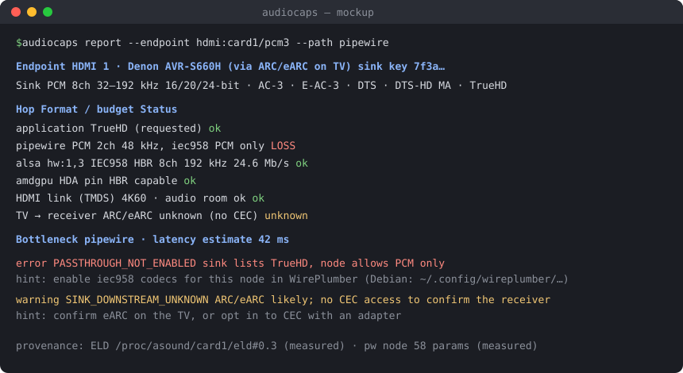

# AudioCaps

<!-- progress:start · generated by scripts/repo-check.mjs progress; do not edit -->

**73% complete** · 34 of 46 tasks · Phase 6 — Sink chain, CEC, quirk data · [Full progress page →](https://stealthx3.github.io/audiocaps/)
<!-- progress:end -->

> "AudioCaps" is a working name; the final name is still to be decided.

AudioCaps is a library that applications bundle to learn exactly what audio the
system can deliver, and where anything is lost on the way. It covers the whole
path, from the connected TV or AV receiver back through host hardware, kernel
drivers, ALSA and the sound server to the application.

## The problem

A Linux application has no single, reliable way to ask: *"What can this audio
output really play through the API I use, and if something is missing, why?"*
The answer is spread across the sink's EDID, the kernel driver, ALSA, the sound
server (PipeWire, PulseAudio, JACK), the Bluetooth stack and the sandbox, and
none of them reports where a capability gets lost. Players offer passthrough
options that fail silently, Bluetooth quietly falls back to lower-quality
codecs, and users end up reading `/proc/asound` ELD files by hand.

## Goals

1. **Identify the connected sink and what it can do** — the specific TV,
   receiver or soundbar, its formats, channels, rates, speaker layout and
   latency, and what sits behind it on ARC/eARC.
2. **Host hardware capabilities** — HDA codecs and pins, GPU HDMI/DP audio, USB
   Audio Class limits, DSP firmware, Bluetooth adapter.
3. **Software capabilities** — what the driver, ALSA, the sound server, codec
   plugins and the sandbox actually let through.
4. **End-to-end pipeline diagnostics** — the bit-rate budget at every hop, the
   bottleneck, and every point where quality or features are lost, with the fix.

Constraints: works fully inside **Flatpak and Snap**, and never disturbs audio
that is already playing.

### Guiding principles

- **Information on-demand:** only what the application asks for is probed and returned.
- **The application decides:** every opt-in (active probes, CEC) runs only when the app calls it.
- **Few languages, bundled use:** a Rust core with a generated C header; apps bundle the library.

## Screenshots and mockups

*Mockup* of the planned `audiocaps report` output. Real screenshots replace it as the CLI lands.

## Features

All features are *(planned)* for Linux 1.0; the progress page above shows what is done.

- Scoped probing with immutable, lock-free snapshots and change events *(planned)*
- Endpoints for HDMI/DP, analog, S/PDIF, USB, Bluetooth, network and virtual sinks; capture; MIDI *(planned)*
- Sink identification from ELD, full EDID and optional CEC, with per-model quirk data *(planned)*
- Per-access-path results (ALSA direct, PulseAudio, PipeWire, JACK) *(planned)*
- Path reports with per-hop bit rate, bottleneck and latency *(planned)*
- Declarative diagnostic rules with distro-aware remediation hints *(planned)*
- Sandbox-aware: reports missing Flatpak permissions or Snap plugs with the exact fix *(planned)*
- Stable C ABI, versioned JSON export with redaction, a CLI, and Flatpak/Snap packaging templates *(planned)*
- Passive capture tool that saves a redacted system snapshot for bug reports and tests *(planned)*

Windows and macOS backends follow Linux 1.0 on the same OS-neutral core.

## Origin

AudioCaps is an original project, not a fork, so there is no upstream to credit
or divergences to list. First consumers: Icefin Player (via mpv) and Argosy Desktop.

## Repository layout

| Path | Contents |
| --- | --- |
| `docs/` | Project documentation (see below) |
| `docs/plan/` | Local review copies of the development plan and local notes (git-ignored) |
| `CLAUDE.md` | Standing instructions for Claude Code |
| `LICENSE`, `NOTICE` | LGPL-2.1-or-later license text and notices |
| `scripts/` | Project tooling: progress page, repo check, lab VMs, phone alerts |
| `crates/` | Cargo workspace: model, parse, backends, rules, ffi, cli |
| `schema/` | Generated JSON schema (v1) |
| `tests/fixtures/` | Redacted system captures and their golden snapshots |

## Documentation

- [Roadmap and task list](docs/PLAN.md)
- [Architecture](docs/architecture.md)
- [JSON schema v1](schema/README.md)
- [Decision & action log](docs/DECISIONS.md)
- [Changelog](docs/CHANGELOG.md)
- [Documentation index](docs/README.md)

## License

LGPL-2.1-or-later. See [LICENSE](LICENSE) and [NOTICE](NOTICE).
